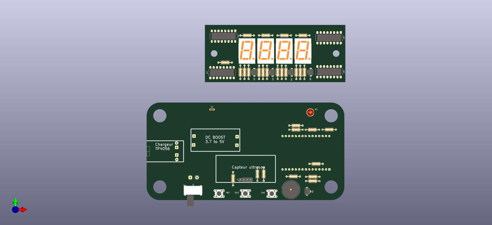

# Industrial ESP32 IoT Hardware & KiCad PCB Ecosystem (Fortico R&D)

[](https://scidelo-andriasahy.github.io/?project=5)
[](https://www.espressif.com/en/products/socs/esp32)
[](https://www.kicad.org/)

> **Author:** Tsikomia Scidelo ANDRIASAHY — Embedded Hardware R&D at [Fortico](https://sitewebfortico.vercel.app/fr)  
> **Live Project Showcase:** [https://scidelo-andriasahy.github.io/?project=5](https://scidelo-andriasahy.github.io/?project=5)



## Four Industrial Embedded Systems Included
1. **SMART_COUNT Industrial Counter PCB:** `ESP32` driving 4 cascaded `74HC595` shift registers + 4 seven-segment displays, ultrasonic object detection, and MQTT reporting.
2. **Automated Smart Incubator PCB:** MOSFET PID thermal loop, DHT22 hygrometry, NEMA 17 egg turning (`DRV8825`), `DS3231` RTC, and 12V/Battery automatic failover.
3. **Multi-Module Fleet Telematics IoT Box:** `ESP32` + `SIM7600` 4G LTE modem + NEO-6M GPS + RFID driver authentication + offline microSD buffering + security relay.
4. **Remote Operator HMI Terminal:** SSD1306 OLED, rotary encoder, and bidirectional `ESP-NOW` / `MQTT` telemetry for power converters.

## Repository Structure
```text
├── hardware/
│   ├── smart_count_kicad/      # Complete KiCad schematic & PCB layout for SMART_COUNT
│   └── smart_incubator_kicad/  # Complete KiCad schematic & PCB layout for Smart Incubator
├── docs/                       # ERC-verified PDF schematics & full functional/firmware specs
└── media/                      # 3D PCB renders & schematic previews
```
